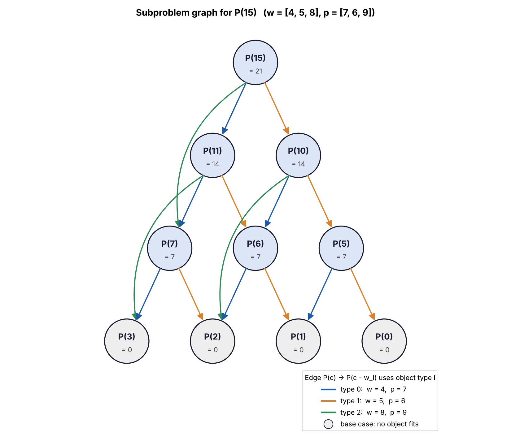

# Part (2): Subproblem Graph for P(15)

## Data

| Type i | 0 | 1 | 2 |
|---|---:|---:|---:|
| Weight w_i | 4 | 5 | 8 |
| Profit p_i | 7 | 6 | 9 |

## How the graph is built

Each vertex is a subproblem `P(c)`. By the definition in part (1),
`P(c)` is computed directly from `P(c - w_i)` for every type `i` that fits.
So there is a directed edge `P(c) -> P(c - w_i)` for every `w_i <= c`.

Start at `P(15)` and keep following edges until no object fits:

| Vertex | Edges (type used) | P(c) |
|---|---|---:|
| P(15) | P(11) (type 0), P(10) (type 1), P(7) (type 2) | 21 |
| P(11) | P(7) (type 0), P(6) (type 1), P(3) (type 2) | 14 |
| P(10) | P(6) (type 0), P(5) (type 1), P(2) (type 2) | 14 |
| P(7) | P(3) (type 0), P(2) (type 1) | 7 |
| P(6) | P(2) (type 0), P(1) (type 1) | 7 |
| P(5) | P(1) (type 0), P(0) (type 1) | 7 |
| P(3) | none: no object fits | 0 |
| P(2) | none: no object fits | 0 |
| P(1) | none: no object fits | 0 |
| P(0) | none: no object fits | 0 |

The graph has **10 vertices and 15 edges**.



Edge colours show which object type each edge uses. Grey vertices are base
cases. The number under each vertex is its value, `P(c)`.

## What the graph shows

1. **Subproblems overlap.** Several vertices have more than one incoming
   edge. For example, `P(7)` is needed by both `P(15)` and `P(11)`, and `P(2)`
   is needed by `P(10)`, `P(7)` and `P(6)`. Plain recursion would solve these
   again every time they are reached. It makes 20 calls for `P(15)`, while the
   graph has only 10 distinct subproblems.

2. **There are no cycles.** Every edge goes from a larger capacity to a
   smaller one, because every weight is positive. So the subproblems can be
   solved in increasing order of capacity, and each subproblem is ready before
   any vertex that needs it. This is the order used by the bottom-up algorithm
   in part (3).

3. **The cost of dynamic programming.** Each vertex is solved once. Solving
   it looks at its outgoing edges, and a vertex has at most `n` of them. The
   total work is proportional to `vertices + edges`, which is `O(nC)` in
   general.

Only capacities that can be reached from 15 by subtracting weights appear in
the graph. Capacities such as 4, 8, 9, 12, 13 and 14 never appear, because no
combination of the weights 4, 5 and 8 takes 15 to them. A bottom-up algorithm
that fills every entry from `P(0)` to `P(15)` still solves those entries, which
is a small amount of extra work.

## Following the best choice

`P(15) = max(7 + P(11), 6 + P(10), 9 + P(7)) = max(21, 20, 16) = 21`, so the
best first choice is type 0. From `P(11)`, type 0 is best again
(`7 + P(7) = 14`), and from `P(7)`, type 0 once more (`7 + P(3) = 7`). `P(3)`
is a base case.

The best packing is three objects of type 0: total weight 12 and total profit
21.

## Code

`part_2_subproblem_graph.py` builds the graph from the definition in part (1),
prints the list above, and draws the picture to
`results/part_2_subproblem_graph_P15.png`. `test_part_2.py` checks the vertices
and edges.

```bash
python3 Lab3/part_2_subproblem_graph.py
python3 -m unittest discover -s Lab3 -p "test_*.py"
```
